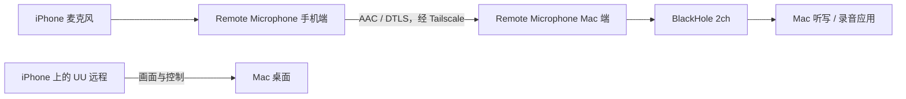
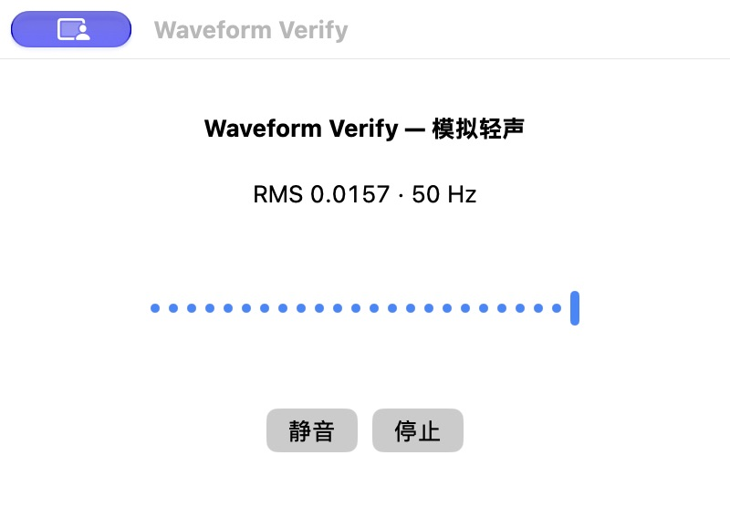
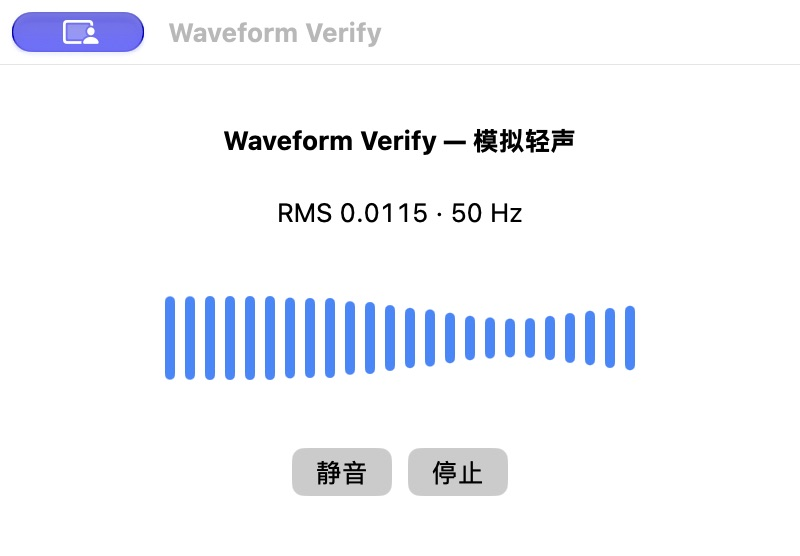
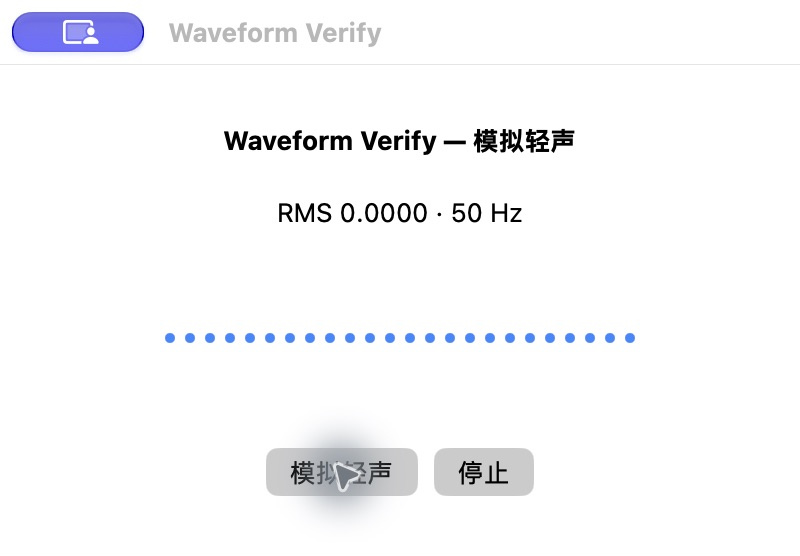

<p align="center"></p>

# Remote Microphone｜把 iPhone 变成 Mac 的远程麦克风

**在外面用 iPhone 连接 UU 远程时，让手机麦克风的声音直接进入 Mac。**

Remote Microphone 是一套用 Swift / SwiftUI 编写的 iPhone 发送端和 Mac 接收端。手机采集声音，经 Tailscale 私有网络传给 Mac，再通过 BlackHole 虚拟音频设备交给听写、录音或会议应用。

最初要解决的问题很具体：用手机远程操作 Mac 时，一弹出手机键盘，远程画面就被压缩。希望保留完整的远程桌面，用手机说话、让 Mac 上的听写应用输入文字。因此，这个项目提供的是一条独立的麦克风通道。

它不修改 UU 客户端，不依赖 UU 自带的远程麦克风支持，也不包含语音识别模型。UU 负责画面和控制，Remote Microphone 负责声音，文字识别由 Mac 上你选择的应用完成。

> 当前为自行构建安装的开发版本。仓库未提供经过公证的正式安装包，也没有 App Store / TestFlight 下载。下面的截图标明了 mock 与原生测试的区别；本次实测结果不代表所有网络和设备均已验证。

## 界面预览

### 手机端与 Mac 端 mock


左侧是手机发送端，右侧是 Mac 接收端。白色背景、浅灰控件和蓝色主按钮，两端使用同一个麦克风图标。

- **手机端**：连接状态、目标 Mac、实时电平波形、开始 / 停止按钮。
- **Mac 端**：当前手机、连接状态、实时波形、BlackHole 设备选择和开始 / 停止接收。
- **配对入口**：右上角二维码按钮；手机可以使用系统相机扫码，或粘贴配对链接。
- **没有独立悬浮按钮**：保持界面简洁，不增加遮挡远程桌面的浮层。

这张图是可交互 HTML mock，使用模拟电平，不是实机传声证明。可以在本机打开：

```sh
python3 -m http.server 38129 --bind 127.0.0.1 --directory mock
```

浏览器访问 <http://127.0.0.1:38129/>，点击手机的开始按钮查看传送状态，点击右上角体验配对面板。

## 主要能力

| 能力 | 当前实现 |
| --- | --- |
| 手机后台收音 | 用户点击开始后，可以切换到 UU 远程；使用 iOS 音频后台模式 |
| 外网连接 | 通过 Tailscale 私有地址连接，支持直连或中继路径 |
| 加密配对 | 随机 256 位预共享密钥，DTLS 1.2 / AES-128-GCM，密钥保存在 Keychain |
| 音频传输 | AAC-LC、48 kHz、单声道、目标编码码率 32 kbps |
| Mac 麦克风输入 | 接收端向 BlackHole 写入，目标应用把 BlackHole 选为输入 |
| 实时波形 | 两端共用 24 根音量柱；稳定 30 Hz 刷新，轻声也能看到变化 |
| 自动恢复 | 网络中断后自动重连；只在新连接确认后恢复发送，不补播断线期间的声音 |
| 有界缓冲 | 发送背压、过期帧丢弃、接收缓冲上限，避免积压数秒旧语音 |
| 明确停止 | 手机停止会取消重连；Mac 收到停止指令后结束对应音频会话 |
| 本地诊断 | 保存状态、格式、计数和电平，不在正常运行中保存语音录音 |

这是音频输入工具，不是 iOS 第三方键盘，不会在其他 App 上创建系统级悬浮输入框。其他远程桌面客户端理论上也能配合这条独立音频通道，但目前实际使用验证以 UU 远程为主。

## 工作原理



1. iPhone 开启音频会话，采集麦克风，并启用系统语音处理。
2. 将实际有效采样帧编码为 AAC 数据包，通过配对后的加密连接发送。
3. Mac 验证连接、解析协议、解码并丢弃明显过期的音频。
4. CoreAudio AUHAL 回调把音频输出到 BlackHole。
5. 听写应用从 BlackHole 读取音频，识别结果由该应用输入到当前窗口。

Tailscale 负责跨网络连通；本项目不部署公网音频服务器，不使用 Funnel，也不自动修改系统默认输入 / 输出设备。目标应用是否进一步把声音发送到云端，取决于它自己的设置。

## 准备环境

| 项目 | 要求与说明 |
| --- | --- |
| iPhone | 工程最低部署目标 iOS 17；需要麦克风权限，真机安装需签名 |
| Mac | 工程最低部署目标 macOS 14；需要安装 BlackHole 2ch |
| 开发工具 | 完整 Xcode，建议 Xcode 26 或更新的 SDK；本轮在 Xcode 27 测试环境构建 |
| 工程生成 | [XcodeGen](https://github.com/yonaskolb/XcodeGen) |
| 私有网络 | iPhone、Mac 均安装并开启 [Tailscale](https://tailscale.com/download)，位于可互通的同一网络 |
| 远程控制 | 自行配置好 UU 远程连接；本项目不管理 UU 登录 |
| 文字输入 | 在 Mac 上使用可选择麦克风的听写应用，例如 Voicemore |

最低部署目标不是完整兼容性清单；旧系统、蓝牙设备、电话中断、锁屏及长期后台运行仍需按实际设备复验。

### 安装 BlackHole

按 [BlackHole 官方安装说明](https://github.com/ExistentialAudio/BlackHole#installation-instructions) 安装 **2ch** 版本，也可以使用 Homebrew：

```sh
brew install blackhole-2ch
```

安装时遵循官方提示关闭音频应用、按需重启。完成后应能在音频设备列表中看到 **BlackHole 2ch**。本仓库不附带驱动二进制，也不会自动重启你的音频服务。

## 从源码构建

### 1. 获取项目

```sh
git clone https://github.com/wherexml/remote-microphone.git
cd remote-microphone
brew install xcodegen
```

确保当前命令行开发目录指向完整 Xcode，而不是只安装了 Command Line Tools：

```sh
xcode-select -p
xcodebuild -version
```

### 2. 设置自己的签名

```sh
cp project.local.example.yml project.local.yml
```

编辑 `project.local.yml`：

- 把两个 `YOUR_TEAM_ID` 替换为 Xcode 中自己的开发团队 ID。
- 把手机和 Mac 的 Bundle ID 改为自己的唯一标识。
- 如果两个平台使用不同团队，可以分别填写。

这个文件已被 Git 忽略，不应提交你的签名配置。`project.yml` 是公开基础配置；本地配置通过 XcodeGen 的 include 机制覆盖签名与 Bundle ID。

```sh
xcodegen generate --spec project.local.yml
open RemoteMic.xcodeproj
```

在 Xcode 的 **Signing & Capabilities** 中确认两个 target 的 Team 和签名设置。iPhone 需完成系统要求的开发者模式、设备信任等步骤。个人开发团队安装可能有有效期限制，按 Xcode 和设备实际提示重新签名；本项目不绕过这些限制。

### 3. 编译和运行

可以在 Xcode 中选择：

- `RemoteMicMac`：运行到本机 Mac。
- `RemoteMicPhone`：运行到连接并解锁的真实 iPhone。

也可以先编译两端：

```sh
scripts/build-local.sh
```

产物位置：

```text
build/DerivedData/Build/Products/Debug/RemoteMic.app
build/PhoneDerivedData/Build/Products/Debug-iphoneos/RemoteMicPhone.app
```

脚本只构建，不自动覆盖 `/Applications` 中的应用，也不自动安装到手机。签名账号或设备授权需要刷新时，在 Xcode 中处理。若仅想检查源码是否可编译：

```sh
scripts/build-local.sh --unsigned
```

未签名构建不等于可以直接在真实 iPhone 上运行。项目没有包含发布、公证或商店上传流程。

## 第一次配对与使用

### Mac 端

1. 打开 Remote Microphone，确认设备列表选择 **BlackHole 2ch**。
2. 保持接收停止状态，点击右上角配对按钮。
3. 从 Tailscale 中找到这台 Mac 的私有 IP 或可解析域名，填入地址框并点击 **保存地址**。请使用你自己的地址，首次启动不会预填开发者的电脑地址。
4. 此时会生成二维码与配对链接。
5. 在手机完成配对后，Mac 点击 **开始接收**。

### iPhone 端

1. 确认 Tailscale 已开启，并且能访问这台 Mac。
2. 用系统相机扫描 Mac 的二维码，打开 Remote Microphone；也可以在 App 的配对页粘贴链接。
3. 点击 **开始**，按系统提示允许麦克风与本地网络访问。
4. 看到 **传送中**，并确认两端波形跟着声音变化。
5. 切回 UU 远程，在 Mac 的听写 / 录音应用中选择 **BlackHole 2ch**。

配对链接包含访问麦克风接收通道的密钥，请不要发到公开 Issue、聊天群或截图中。知道该密钥的设备可以建立经过认证的连接；新会话可能替换旧会话。

### 配合 UU 远程

**使用手机麦克风时，关闭 iPhone 上 UU 的“电脑声音 / 远程声音”播放。** Mac 的声音从手机扬声器播放后再次进入麦克风，可能形成回音甚至越来越大的啸叫。系统语音处理不能保证消除跨应用回传反馈。

听写软件中的麦克风要选择 **BlackHole 2ch**。如果选中 Apple 连续互通的 iPhone 麦克风，那是另一条输入路径，可能出现“iPhone 正作为 Mac 麦克风”的系统页面。

离开或结束使用时，在手机点击 **停止**；也可以停止 Mac 接收。网络中断本身不会取消用户已开始的会话，手机会继续尝试重连，直到用户停止或发生音频中断。iOS 的录音指示会持续显示。

## 排查：为什么波形不明显、连接超时或没有文字？

### 波形几乎只有一排小点

这是开发过程中实际复现并修复过的问题。原先在 SwiftUI 的 `body` 中创建定时器，持续输入电平时，订阅会反复重建，历史波形无法正常推进；同时，直接按线性 RMS 绘制会让轻声几乎看不见。

下面是**同一个原生组件、相同模拟输入范围**的前后对照，输入每 20 毫秒更新一次。它是渲染排查截图，不是真实手机录音或识别准确率证明。

| 修复前 | 修复后 |
| --- | --- |
|  |  |

修复后使用持久的定时器、30 Hz 刷新，以及 −60 到 −18 dBFS 的显示映射。只改变视觉高度，不放大传输声音。停止会清空历史；静音后波形回到小点，不播放装饰性的假动画。



### 常见问题对照

| 现象 | 优先检查 |
| --- | --- |
| 手机显示连接中 / 重新连接中 | 手机 Tailscale 是否真的开启；Mac 地址是否正确；Mac 是否已开始接收 |
| Wi-Fi 能用，蜂窝网络不稳定 | 关闭 Wi-Fi 做独立测试；检查 Tailscale 直连 / 中继路径与网络丢包，不能用同局域网成功代替外网验证 |
| 手机波形动，Mac 不动 | 先看 Mac 是否已连接；检查网络、配对地址以及手机是否已进入传送状态 |
| 两端波形动，但没有文字 | 听写软件是否选择 BlackHole，是否已触发听写，识别服务本身是否正常；波形不是识别成功证明 |
| 出现连续互通麦克风页面 | 听写软件可能选了系统的 iPhone 麦克风；改选 BlackHole 2ch |
| 回音、越来越大的啸叫 | 立即停止；关闭 UU 的电脑声音，避免把 BlackHole 监听回扬声器；再重新测试 |
| 蓝牙耳机 / 电话后停止 | 音频路由变化与系统中断会明确停录，需要回手机重新开始 |
| 新连接一直被旧连接挡住 | 使用包含认证后会话替换修复的版本；未认证连接不会占用唯一音频通道 |
| 测试录音全空 | 区分真实静音和“根本没有输入回调”；检查实际设备格式，而不只看设备名称 |

测试工具曾遇到“设备 ID 已切到 BlackHole，但 AVAudioEngine 仍沿用旧设备 24 kHz 格式”的情况。现在独立捕获程序直接使用 AUHAL 读取 BlackHole 的实际硬件格式；没有回调会明确报错，避免把空录音当成成功。

## 验证与已知边界

截至 2026-10-26，本地实机验证覆盖：

| 验证项 | 结果与范围 |
| --- | --- |
| 加密传输 | 真实 DTLS 套接字数据往返；错误配对密钥拒绝 |
| 音频回环 | 生产 AAC 编码 → 安装版接收器 → BlackHole → 独立捕获；440 Hz、过期帧静音、停止静音通过 |
| 连接替换 | 未认证连接不阻塞合法连接；已认证新会话可替换旧会话 |
| 波形 | 原生模拟前后对照通过，真实手机灵敏度获使用者确认 |
| Wi-Fi 使用 | 手机后台配合 UU，BlackHole 输入与实际听写已跑通 |
| 本轮蜂窝网络 | 约 368 秒连续连接，接收约 366 秒音频；观察到缓冲丢弃，不宣称零丢包 |
| 中断恢复 | 将 Mac 接收进程暂停 40 秒，恢复后约 9 秒重新收到音频，无需再次点击手机开始 |
| 实际输入 | 独立 BlackHole 捕获有真实非零语音；指定句准确率、完整听写服务质量没有因此被证明 |

这些是单次、特定设备和链路的验证结果。中继延迟、运营商网络、漫游、低电量、锁屏、蓝牙与系统音频中断都可能影响体验。诊断中的“额外排队时间”不是从开口到文字显示的端到端延迟。

### 可重复的端到端检查

```sh
# 真实本机套接字与错误密钥检查，不需要你的配对密钥
scripts/verify-transport.sh

# 原生波形夹具：只使用明确的模拟电平
scripts/build-waveform-verifier.sh
open build/WaveformVerify.app
```

音频和会话恢复检查需要先启动 Mac 接收端、停止手机发送，并将自己复制的配对链接保存在本机 `private/pairing-url.txt` 中。不要把链接直接放进命令行或提交到仓库。

```sh
mkdir -p private
# 使用编辑器保存配对链接，然后限制文件权限
chmod 600 private/pairing-url.txt

# 建议指定自己的稳定签名身份，测试程序会请求麦克风权限
export REMOTE_MIC_SIGN_IDENTITY='Apple Development: 你的证书名称'
scripts/verify-loopback.sh private/pairing-url.txt
scripts/verify-recovery.sh private/pairing-url.txt
```

未设置 `REMOTE_MIC_SIGN_IDENTITY` 时，独立夹具使用临时签名；权限稳定性可能随重建变化。请按 Xcode / 系统权限提示处理。测试会输出合成声音到 BlackHole，不能同时让真实手机会话参与该回归。

产物保存在 `artifacts/`：协议 JSON、回环 JSON、恢复 JSON、测试 WAV 与哈希。正常应用不录音落盘；**独立验收工具会录制 BlackHole 输入**，默认 20 秒，可通过 `REMOTE_MIC_CAPTURE_SECONDS` 调整（5–600 秒）。这整个目录被 Git 忽略。

可选离线回放工具 `scripts/transcribe-local.py` 需要自行安装 `numpy`、`sherpa-onnx`、FFmpeg，并通过 `SHERPA_MODEL_DIR` 指定兼容的 bilingual transducer 模型目录。它只是辅助分析工具，不是应用依赖，也不代表真实听写软件的识别链路。

## 项目结构

```text
Shared/       配对、加密协议、PCM/AAC 编解码、共享视觉组件
Mac/          Mac 接收界面与 CoreAudio 输出
iOS/          手机收音、后台会话、重连与界面
mock/         可交互 HTML 界面预览
e2e/          真实套接字、音频捕获、会话恢复、波形验证夹具
scripts/      构建与验收脚本
docs/         中文设计、故障边界及公开截图
assets/brand/ 两端共享图标原稿
third-party/  第三方许可说明
```

更多约定见 [界面与实现规格](docs/DESIGN.md)、[故障与验收边界](docs/FAILURE-MODES.md)。

## 隐私、协议与诊断

- 手机仅在用户明确开始后采集，系统显示录音指示；后台自动重连属于该已开始会话。
- 正常应用不保存语音文件；诊断不包含配对密钥或音频正文。
- Mac 诊断位于 `~/Library/Application Support/RemoteMic/diagnostics.json`，手机诊断位于自身容器 `Documents/diagnostics.json`。
- 协议 v4 使用序列号去重，重试幂等控制消息，丢弃旧音频，不重传积压语音。
- 使用单调时钟相对 HELLO 的增量判断额外排队延迟，避免两台设备时钟偏差误丢声音。
- 握手超时为 45 秒，已建立连接连续 30 秒未收包会关闭并触发手机重连；退避间隔上限 8 秒。恢复耗时还取决于实际网络和握手。
- Mac 最多保留四个待认证连接，只有验证成功的新会话才能替换当前音频通道；同一时间只输出一路声音。
- 这些是实现说明，不是第三方安全审计结论。不要公开配对二维码、链接、原始诊断或测试录音。

## 贡献

欢迎通过 Issue 描述可复现的问题，或提交 PR。请说明系统版本、Wi-Fi / 蜂窝、Tailscale 直连 / 中继、麦克风路由，以及问题出现在哪个阶段；截图先遮去个人信息与配对内容。

优先提供真实端到端复验：从输入、网络、解码、BlackHole 到目标应用逐段确认。修改界面先更新 mock；波形必须对应真实测量值。请勿把本地合成测试描述为真机、外网或识别准确率通过。

## 许可证与第三方

本项目自有代码以 [MIT 许可证](LICENSE) 开源。共享图标使用 OpenAI imagegen 生成，说明见 [图标来源](assets/brand/README.md)。

[BlackHole](https://github.com/ExistentialAudio/BlackHole) 是独立第三方项目，使用其自身的 GPL-3.0 许可证；许可文本和说明见 [third-party](third-party/README.md)。本仓库没有包含或改写其驱动源码、二进制和安装包；自行分发第三方组件时应遵循对应许可证。

UU 远程、Tailscale、Apple 相关名称属于各自权利人。本项目为独立开源工具，与这些产品无官方隶属关系。
