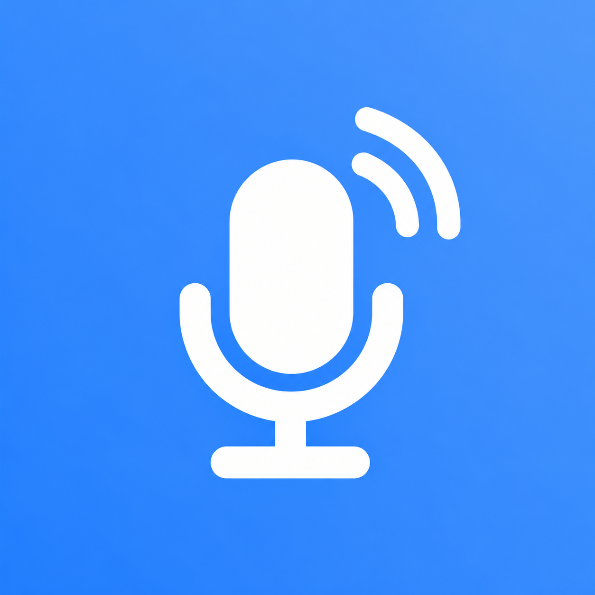
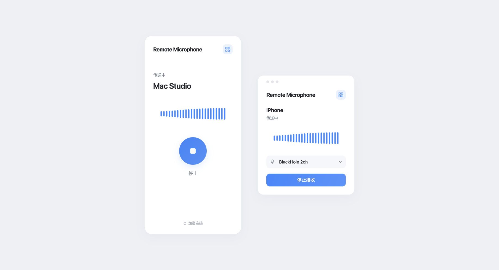
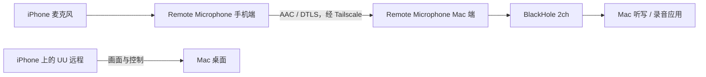

<p align="center"></p>

# Remote Microphone｜把 iPhone 变成 Mac 的远程麦克风

**在外面用 iPhone 连接 UU 远程时，让手机麦克风的声音直接进入 Mac。**

Remote Microphone 是一套用 Swift / SwiftUI 编写的 iPhone 发送端和 Mac 接收端。手机采集声音，经 Tailscale 私有网络传给 Mac，再通过 BlackHole 虚拟音频设备交给听写、录音或会议应用。

最初要解决的问题很具体：用手机远程操作 Mac 时，一弹出手机键盘，远程画面就被压缩。希望保留完整的远程桌面，用手机说话、让 Mac 上的听写应用输入文字。因此，这个项目提供的是一条独立的麦克风通道。

它不修改 UU 客户端，不依赖 UU 自带的远程麦克风支持，也不包含语音识别模型。UU 负责画面和控制，Remote Microphone 负责声音，文字识别由 Mac 上你选择的应用完成。

> 当前为自行构建安装的开发版本。仓库未提供经过公证的正式安装包，也没有 App Store / TestFlight 下载。界面预览为设计 mock。

## 界面预览

### 手机端与 Mac 端 mock



左侧是手机发送端，右侧是 Mac 接收端。白色背景、浅灰控件和蓝色主按钮，两端使用同一个麦克风图标。

- **手机端**：连接状态、目标 Mac、实时电平波形、开始 / 停止按钮。
- **Mac 端**：当前手机、连接状态、实时波形、BlackHole 设备选择和开始 / 停止接收。
- **配对入口**：右上角二维码按钮；手机可以使用系统相机扫码，或粘贴配对链接。
- **没有独立悬浮按钮**：保持界面简洁，不增加遮挡远程桌面的浮层。

## 主要能力

| 能力 | 当前实现 |
| --- | --- |
| 手机后台收音 | 用户点击开始后，可以切换到 UU 远程；使用 iOS 音频后台模式 |
| 外网连接 | 通过 Tailscale 私有地址连接，支持直连或中继路径 |
| 加密配对 | 随机 256 位预共享密钥，DTLS 1.2 / AES-128-GCM，密钥保存在 Keychain |
| 音频传输 | AAC-LC、48 kHz、单声道、目标编码码率 32 kbps |
| Mac 麦克风输入 | 接收端向 BlackHole 写入，目标应用把 BlackHole 选为输入 |
| 实时波形 | 两端共用 24 根音量柱；稳定 30 Hz 刷新，轻声也能看到变化 |
| 自动恢复 | 网络中断后自动重连；只在新连接确认后恢复发送，不补播断线期间的声音 |
| 有界缓冲 | 发送背压、过期帧丢弃、接收缓冲上限，避免积压数秒旧语音 |
| 明确停止 | 手机停止会取消重连；Mac 收到停止指令后结束对应音频会话 |
| 本地诊断 | 保存状态、格式、计数和电平，不在正常运行中保存语音录音 |

这是音频输入工具，不是 iOS 第三方键盘，不会在其他 App 上创建系统级悬浮输入框。其他远程桌面客户端理论上也能配合这条独立音频通道，但目前实际使用验证以 UU 远程为主。

## 工作原理



1. iPhone 开启音频会话，采集麦克风，并启用系统语音处理。
2. 将实际有效采样帧编码为 AAC 数据包，通过配对后的加密连接发送。
3. Mac 验证连接、解析协议、解码并丢弃明显过期的音频。
4. CoreAudio AUHAL 回调把音频输出到 BlackHole。
5. 听写应用从 BlackHole 读取音频，识别结果由该应用输入到当前窗口。

Tailscale 负责跨网络连通；本项目不部署公网音频服务器，不使用 Funnel，也不自动修改系统默认输入 / 输出设备。目标应用是否进一步把声音发送到云端，取决于它自己的设置。

## 准备环境

| 项目 | 要求与说明 |
| --- | --- |
| iPhone | 工程最低部署目标 iOS 17；需要麦克风权限，真机安装需签名 |
| Mac | 工程最低部署目标 macOS 14；需要安装 BlackHole 2ch |
| 开发工具 | 完整 Xcode，建议 Xcode 26 或更新的 SDK；本轮在 Xcode 27 测试环境构建 |
| 工程生成 | [XcodeGen](https://github.com/yonaskolb/XcodeGen) |
| 私有网络 | iPhone、Mac 均安装并开启 [Tailscale](https://tailscale.com/download)，位于可互通的同一网络 |
| 远程控制 | 自行配置好 UU 远程连接；本项目不管理 UU 登录 |
| 文字输入 | 在 Mac 上使用可选择麦克风的听写应用，例如 Voicemore |

最低部署目标不是完整兼容性清单；旧系统、蓝牙设备、电话中断、锁屏及长期后台运行仍需按实际设备复验。

### 安装 BlackHole

按 [BlackHole 官方安装说明](https://github.com/ExistentialAudio/BlackHole#installation-instructions) 安装 **2ch** 版本，也可以使用 Homebrew：

```sh
brew install blackhole-2ch
```

安装时遵循官方提示关闭音频应用、按需重启。完成后应能在音频设备列表中看到 **BlackHole 2ch**。本仓库不附带驱动二进制，也不会自动重启你的音频服务。

## 从源码构建

### 1. 获取项目

```sh
git clone https://github.com/wherexml/remote-microphone.git
cd remote-microphone
brew install xcodegen
```

确保当前命令行开发目录指向完整 Xcode，而不是只安装了 Command Line Tools：

```sh
xcode-select -p
xcodebuild -version
```

### 2. 设置自己的签名

```sh
cp project.local.example.yml project.local.yml
```

编辑 `project.local.yml`：

- 把两个 `YOUR_TEAM_ID` 替换为 Xcode 中自己的开发团队 ID。
- 把手机和 Mac 的 Bundle ID 改为自己的唯一标识。
- 如果两个平台使用不同团队，可以分别填写。

这个文件已被 Git 忽略，不应提交你的签名配置。`project.yml` 是公开基础配置；本地配置通过 XcodeGen 的 include 机制覆盖签名与 Bundle ID。

```sh
xcodegen generate --spec project.local.yml
open RemoteMic.xcodeproj
```

在 Xcode 的 **Signing & Capabilities** 中确认两个 target 的 Team 和签名设置。iPhone 需完成系统要求的开发者模式、设备信任等步骤。个人开发团队安装可能有有效期限制，按 Xcode 和设备实际提示重新签名；本项目不绕过这些限制。

### 3. 编译和运行

可以在 Xcode 中选择：

- `RemoteMicMac`：运行到本机 Mac。
- `RemoteMicPhone`：运行到连接并解锁的真实 iPhone。

也可以先编译两端：

```sh
scripts/build-local.sh
```

产物位置：

```text
build/DerivedData/Build/Products/Debug/RemoteMic.app
build/PhoneDerivedData/Build/Products/Debug-iphoneos/RemoteMicPhone.app
```

脚本只构建，不自动覆盖 `/Applications` 中的应用，也不自动安装到手机。签名账号或设备授权需要刷新时，在 Xcode 中处理。若仅想检查源码是否可编译：

```sh
scripts/build-local.sh --unsigned
```

未签名构建不等于可以直接在真实 iPhone 上运行。Mac 公证 DMG 与 iPhone 自行签名 IPA 的打包步骤见 [Release 分发说明](docs/RELEASE.md)。

## 第一次配对与使用

### Mac 端

1. 打开 Remote Microphone，确认设备列表选择 **BlackHole 2ch**。
2. 保持接收停止状态，点击右上角配对按钮。
3. 从 Tailscale 中找到这台 Mac 的私有 IP 或可解析域名，填入地址框并点击 **保存地址**。请使用你自己的地址，首次启动不会预填开发者的电脑地址。
4. 此时会生成二维码与配对链接。
5. 在手机完成配对后，Mac 点击 **开始接收**。

### iPhone 端

1. 确认 Tailscale 已开启，并且能访问这台 Mac。
2. 用系统相机扫描 Mac 的二维码，打开 Remote Microphone；也可以在 App 的配对页粘贴链接。
3. 点击 **开始**，按系统提示允许麦克风与本地网络访问。
4. 看到 **传送中**，并确认两端波形跟着声音变化。
5. 切回 UU 远程，在 Mac 的听写 / 录音应用中选择 **BlackHole 2ch**。

配对链接包含访问麦克风接收通道的密钥，请不要发到公开 Issue、聊天群或截图中。知道该密钥的设备可以建立经过认证的连接；新会话可能替换旧会话。

### 配合 UU 远程

**使用手机麦克风时，关闭 iPhone 上 UU 的“电脑声音 / 远程声音”播放。** Mac 的声音从手机扬声器播放后再次进入麦克风，可能形成回音甚至越来越大的啸叫。系统语音处理不能保证消除跨应用回传反馈。

听写软件中的麦克风要选择 **BlackHole 2ch**。如果选中 Apple 连续互通的 iPhone 麦克风，那是另一条输入路径，可能出现“iPhone 正作为 Mac 麦克风”的系统页面。

离开或结束使用时，在手机点击 **停止**；也可以停止 Mac 接收。网络中断本身不会取消用户已开始的会话，手机会继续尝试重连，直到用户停止或发生音频中断。iOS 的录音指示会持续显示。

## 贡献

欢迎通过 Issue 描述可复现的问题，或提交 PR。请说明系统版本、Wi-Fi / 蜂窝、Tailscale 直连 / 中继、麦克风路由，以及问题出现在哪个阶段；截图先遮去个人信息与配对内容。

优先提供真实端到端复验：从输入、网络、解码、BlackHole 到目标应用逐段确认。修改界面先更新 mock；波形必须对应真实测量值。请勿把本地合成测试描述为真机、外网或识别准确率通过。

## 许可证与第三方

本项目自有代码以 [MIT 许可证](LICENSE) 开源。共享图标使用 OpenAI imagegen 生成，说明见 [图标来源](assets/brand/README.md)。

[BlackHole](https://github.com/ExistentialAudio/BlackHole) 是独立第三方项目，使用其自身的 GPL-3.0 许可证；许可文本和说明见 [third-party](third-party/README.md)。本仓库没有包含或改写其驱动源码、二进制和安装包；自行分发第三方组件时应遵循对应许可证。

UU 远程、Tailscale、Apple 相关名称属于各自权利人。本项目为独立开源工具，与这些产品无官方隶属关系。
